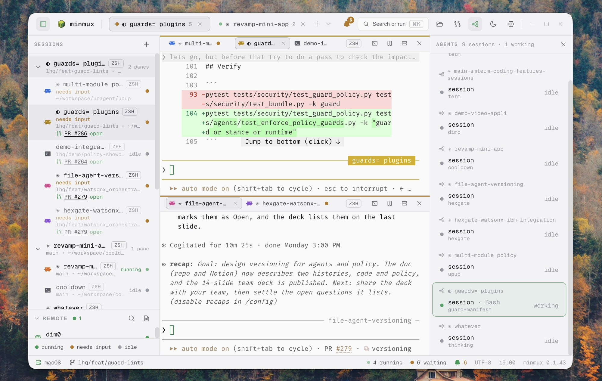
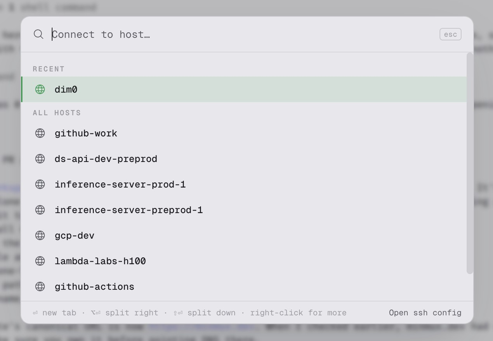
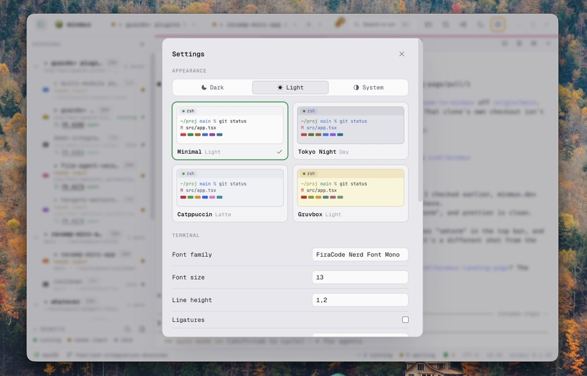

<p align="center">
  
</p>

<h1 align="center"><a href="https://minmux.dev">minmux</a></h1>

<p align="center">A minimal terminal for agentic coding, built to keep you in the loop (yes we love reading the code).</p>

<p align="center"><sub>Works with <b>Claude Code</b>, <b>Codex</b> and <b>OpenCode</b>.</sub></p>

<p align="center">
  <a href="https://github.com/vcmf/minmux/releases/latest"></a>
  <a href="https://github.com/vcmf/minmux/actions/workflows/ci.yml"></a>
  <a href="LICENSE"></a>
  
</p>

<p align="center">If minmux looks useful to you, a ⭐ helps other people find it.</p>

<p align="center">
  
</p>

**minmux** is a terminal (tabs, split panes, your real shells) for people who run coding agents
all day. Run `claude`, `codex` or `opencode` in a pane as you always do, and minmux shows what
each one is doing: which session needs you, what its sub-agents are up to, which files changed,
and the diff. The pull requests they open are in the same window, with their reviews and CI.

## Why minmux

- Your agents run unmodified. minmux listens through each agent's own hooks or plugin system,
  so there is no wrapper CLI to learn and no proxy between you and the model.
- minmux only wires the panes it opens. Your `~/.claude`, `~/.codex` and OpenCode config stay as
  they are, and an agent started anywhere else is untouched. (Approving minmux's hooks in Codex
  is recorded by Codex in its own config.)
- Quit minmux with an agent running and reopen it: that session comes back in the same pane, in
  the same folder.
- The shell is yours, with your rc files, your `ssh` and your keys. Splits keep the shell and
  the folder, and the layout comes back after a restart.
- There is no telemetry and no account. The one request minmux makes on its own is a check for a
  newer release on GitHub. Everything about pull requests goes through your own `gh`.
- The terminal renders on WebGL and uses no CPU when idle. Agent tracking runs off the path your
  keystrokes and output take ([measurements](docs/PERF.md)).

## Install

macOS and Linux:

```
curl -fsSL https://raw.githubusercontent.com/vcmf/minmux/main/install.sh | sh
```

Windows (PowerShell):

```
irm https://raw.githubusercontent.com/vcmf/minmux/main/install.ps1 | iex
```

The script downloads the latest release from GitHub and puts it in `/Applications` on macOS
(`~/Applications` if that isn't writable), in `~/.local/bin/minmux` on Linux, and runs the
installer on Windows. Read [install.sh](install.sh) or [install.ps1](install.ps1) first if you
like. The agents themselves are not included: install `claude`, `codex` or `opencode` as usual.

## A closer look

<table>
  <tr>
    <td width="42%"></td>
    <td><b>Agents panel.</b> Every Claude Code, Codex and OpenCode session, grouped like the sidebar, with the pane you're in outlined. Each row gives its state and when it last did something. Open one to see its branch, session id, token count, the sub-agents it started and the processes it runs (a dev server, a test watcher). Click a row to jump to its pane.<br /><br />Past sessions are listed below the open ones. Search their conversations, filter by agent or by the current folder, and resume one in a split.</td>
  </tr>
  <tr>
    <td colspan="2"><b>Pull requests.</b> A dialog with your PRs, the ones waiting for your review, and the focused pane's repo. Each row shows whether it is approved, behind its base, or still running CI, and stacked PRs sit under the PR they build on. Select one to read its description, conversation and review threads, follow its checks and commits as CI runs, request reviewers, comment, approve, update the branch, mark it ready, or merge it. It runs your own <code>gh</code>, and every account you're logged in to.<br /><br /></td>
  </tr>
  <tr>
    <td width="42%"></td>
    <td><b>Notifications when a session needs you.</b> A dot on the tab and a native OS notification the moment a background pane wants input or finishes.</td>
  </tr>
  <tr>
    <td width="42%"></td>
    <td><b>Every session and pane at a glance.</b> The sidebar tree shows each session, its panes, and a status dot: running, needs input, or idle.</td>
  </tr>
  <tr>
    <td width="42%"></td>
    <td><b>SSH sessions.</b> Your <code>~/.ssh/config</code> hosts in one picker, recent first. Enter opens a tab, ⌥Enter splits right, ⇧Enter splits down. It runs your own <code>ssh</code>, so keys, agents and 2FA prompts work as usual, and splits stay on the host. <a href="docs/SSH.md">More on SSH.</a></td>
  </tr>
  <tr>
    <td width="42%"></td>
    <td><b>Folders and files as tabs.</b> Open a terminal's folder as a tab beside it, or click a path in the output. Changed files carry git marks; a folder's +/− lists only what changed, and a changed file shows its highlighted diff. Files minmux can't show open in their own app, and nothing is ever run.</td>
  </tr>
  <tr>
    <td width="42%"></td>
    <td><b>Open a file and read it.</b> Click a file to open an inline preview and read what an agent wrote, without leaving the terminal.</td>
  </tr>
  <tr>
    <td width="42%"></td>
    <td><b>Themes and settings.</b> Minimal, Tokyo Night, Catppuccin and Gruvbox, each in dark and light, or following the system. Fonts, size and line height sit right below, all backed by one <code>settings.json</code>.</td>
  </tr>
</table>

## Agents

|                 | Panel and sub-agents | Tokens | Name and colour                   | Resume after restart                 | Setup            |
| --------------- | -------------------- | ------ | --------------------------------- | ------------------------------------ | ---------------- |
| **Claude Code** | yes                  | yes    | `/rename`, `/color`               | yes                                  | none             |
| **Codex**       | yes                  | yes    | its name; colour after `/rename`  | yes, confirmed at your first message | approve `/hooks` |
| **OpenCode**    | yes, nested          | yes    | its title; colour after `/rename` | yes                                  | none             |

- A pane's colour is your choice: Claude's `/color`, or a name you gave the session. Names an
  agent picks for itself are shown in plain text.
- **Codex** asks you to approve minmux's hooks once, and again when a minmux update changes
  them. When it does, a strip in the pane says how: type `/hooks` in Codex and press `t`.
- Claude Code and Codex are wired in zsh and bash panes; OpenCode in any shell.
- **OpenCode** gets a small minmux plugin in the panes minmux opens, next to your own plugins.
- Each integration can be switched off in Settings. Codex and OpenCode are not wired on Windows
  or in WSL panes yet.

## Who it's for

People who run agents in a terminal, want to see what they are doing without leaving it, and
still read and edit the code themselves.

If you want an IDE, a chat interface, or a tool that plans and runs the agents for you, minmux
is the wrong fit. You start and steer every agent yourself.

## Why I built this

I love the terminal, and the easiest way to put an agent like Claude Code to work is to launch
it from a CLI. But I also like reading the code an agent writes and making the edits myself, and
a plain terminal makes that hard: you lose track of which session needs you, and you never
really see what changed. minmux keeps the shell I already like and adds just enough to stay in
the loop: folder and file tabs (with their git changes) and the Agents panel show what
happened, not just that something did. It also behaves the same on macOS, Linux and WSL, which helps since my work moves between
all three.

## More

- **SSH.** The hosts in your `~/.ssh/config` are one click away; splits stay on the host, and a
  dropped connection reconnects. [Everything about SSH](docs/SSH.md).
- **Settings.** One `settings.json`, editable by hand or in the app, applied as you save.
  [Configuration](docs/CONFIGURATION.md).
- **Keyboard.** A command palette (⌘K) for sessions, splits, themes and settings; find in
  scrollback with `Cmd`/`Ctrl+Shift` + `F`.

## What is still rough

This is v0. I use it every day, and it will still surprise you sometimes.

- On macOS it is Apple Silicon only for now. Intel is not built yet.
- The app is not code-signed or notarized, so installing it outside the script gives you a
  security prompt the first time.
- A pane's status (working, needs input, idle) comes partly from a heuristic (is the pane still
  producing output?), so it reads wrong once in a while.
- The Agents panel knows Claude Code, Codex and OpenCode. Another agent needs its own adapter.
- The pull requests dialog talks to github.com through `gh`. GitHub Enterprise hosts are not
  supported yet.
- Windows and WSL have had far less real-world use than macOS and Linux, so expect rougher edges
  there.
- After a full quit, your layout and your agents' sessions come back, but other running
  processes (a dev server, a build) do not.

Found a bug or want something? [Open an issue](https://github.com/vcmf/minmux/issues/new/choose).
What you did, what happened, and what you expected is all it takes for a useful report. PRs are
welcome too: see [CONTRIBUTING.md](CONTRIBUTING.md).

## Build from source

```
git clone https://github.com/vcmf/minmux
cd minmux
make install   # deps, native module rebuild, git hooks
make run       # dev mode
make dist      # package an installable build for your OS
```

`make run` uses its own **dev profile** (`~/.config/minmux-dev`, `%APPDATA%\minmux-dev` on
Windows; a DEV badge by the logo), so it runs next to an installed minmux without touching its
settings or layout.
`MINMUX_PROFILE=<name> make run` picks another profile (one per worktree, say);
`MINMUX_PROFILE=default` uses the installed app's config, only while that app is closed. An
installed minmux ignores `MINMUX_PROFILE`; start it with `--profile=<name>` instead (macOS:
`open -a minmux --args --profile=qa`).

Run `make help` for the full list of targets (`make check` runs lint + tests, `make fmt`
formats). Logic lives in small pure modules with real tests (`make test`).

The stack: Electron, React and TypeScript, built with electron-vite. Terminals are xterm.js on
the WebGL renderer, with node-pty for the shells. Zustand holds the state,
react-resizable-panels the layout, and Vitest runs the tests.

```
electron/          main process: the PTYs, shell integration, git and gh, ssh
  agents/          one adapter per agent (Claude Code, Codex, OpenCode): hooks, parsing, resume
src/               the renderer (React)
  terminal/        xterm and its PTY, kept outside React so a pane can move without a respawn
  lib/             pure logic with unit tests: pane tree, workspace, session status, …
  components/      top bar, sidebar, panes, panels and dialogs
  settings/        settings schema and themes
docs/              architecture, roadmap, gotchas, design docs
```

Design and decisions live in [`docs/`](docs/): start with
[ARCHITECTURE.md](docs/ARCHITECTURE.md) and [ROADMAP.md](docs/ROADMAP.md).

## Uninstall

- macOS: delete `minmux.app` from `/Applications` (or `~/Applications`).
- Linux: delete `~/.local/bin/minmux` (and `~/.local/bin/smterm`, if the installer left that
  link from the app's old name).
- Windows: Settings > Apps > Installed apps > minmux.

For a clean slate, also delete your settings and layout in `~/.config/minmux`
(`%APPDATA%\minmux` on Windows) and, on macOS, the app's data in
`~/Library/Application Support/minmux`.

## License

[MIT](LICENSE). Do what you want with it.
